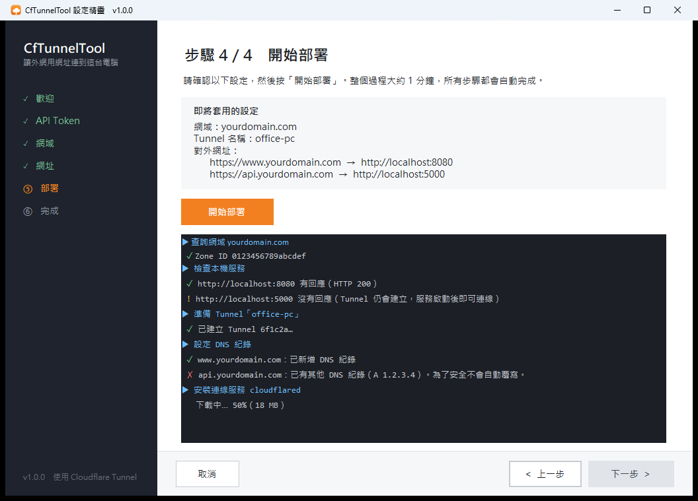
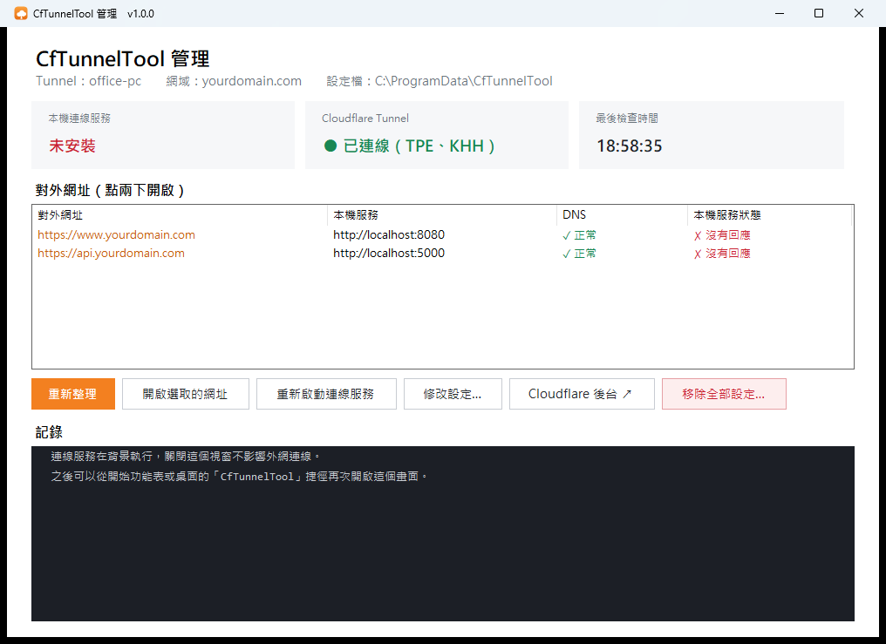

# CfTunnelTool

一個 Windows 圖形介面工具，透過 **Cloudflare Tunnel** 讓外網用你自己的網域連到這台電腦上的網站和 API。

- 不需要固定 IP、不用設定路由器 Port Forwarding、不用開防火牆
- Cloudflare 自動提供 HTTPS
- 安裝成 Windows 服務，開機自動連線
- 整個流程都有逐步引導，約 5 分鐘完成

```
瀏覽器 ──HTTPS──▶ Cloudflare ◀══ 加密通道（由內往外）══ cloudflared 服務 ──▶ localhost:80 / :5000
```



## 下載與安裝

1. 到 [Releases](../../releases/latest) 下載 `CfTunnelTool-<版本>-win-x64.zip`（私有 repo 需要先登入 GitHub）
2. 解壓縮後按兩下 `CfTunnelTool.exe`（單一檔案，不需要安裝 .NET）
3. 若出現「Windows 已保護您的電腦」，按「其他資訊」→「仍要執行」（程式沒有程式碼簽章）
4. Windows 詢問權限時按「是」，接著跟著精靈完成四個步驟

也可以用 GitHub CLI 下載：

```bash
gh release download --repo ad823/CfTunnelTool --pattern "*.zip"
```

zip 內附的 [使用說明.txt](docs/使用說明.txt) 有完整步驟和第一次部署的驗證清單。

## 設定精靈

| 步驟 | 內容 |
|---|---|
| 1. API Token | 按按鈕開啟 Cloudflare 頁面，依畫面上的表格建立 Token、貼上、驗證（程式會檢查權限是否足夠） |
| 2. 網域 | 從下拉選單選網域，取一個 Tunnel 名稱（預設為電腦名稱） |
| 3. 網址 | 設定「子網域 → 本機服務」，例如 `api` → `http://localhost:5000`，可以直接測試本機服務有沒有回應 |
| 4. 部署 | 按「開始部署」，自動完成 Tunnel、DNS、下載 cloudflared、安裝服務，並即時顯示進度 |

<table>
<tr>
<td></td>
<td></td>
</tr>
</table>

完成後：

- 程式會把自己安裝到 `C:\Program Files\CfTunnelTool\`，並在**開始功能表和桌面**建立「CfTunnelTool」捷徑
- 之後開啟捷徑會直接進入**管理畫面**，可以查看服務與 Tunnel 狀態、測試本機服務、開啟網址、重新啟動服務、修改網址、移除全部設定



## 安全設計

- **不會覆寫你現有的 DNS**：網址已有 A/AAAA 紀錄時會停下來提醒，指向其他 Tunnel 的紀錄會先詢問
- **不會誤用別台電腦的 Tunnel**：同名 Tunnel 已存在時會先詢問；移除時只刪除這台電腦建立的 Tunnel 與 DNS
- **API Token 以 Windows DPAPI 加密**存在 `C:\ProgramData\CfTunnelTool\token.dat`，只有同一個 Windows 使用者能解開（也可以選擇不記住）
- 服務使用的是 Cloudflare 產生的 Tunnel Token，只能連這一條 Tunnel，權限比 API Token 小

> 網站和 API 公開後任何人都能連線，請務必做好登入驗證。
> 只給內部使用的網址，可以在 Cloudflare 後台 → Zero Trust → Access → Applications 加上登入保護。

## 檔案位置

| 位置 | 內容 |
|---|---|
| `C:\ProgramData\CfTunnelTool\config.json` | 網域、Tunnel、網址設定（不含密鑰） |
| `C:\ProgramData\CfTunnelTool\token.dat` | 加密後的 API Token |
| `C:\Program Files\CfTunnelTool\CfTunnelTool.exe` | 管理程式 |
| `C:\Program Files\cloudflared\cloudflared.exe` | Cloudflare 官方連線程式（從官方 GitHub 下載） |
| Windows 服務 `Cloudflared` | 開機自動執行的連線服務 |

## 開發

需要 .NET 9 SDK。

| 路徑 | 內容 |
|---|---|
| `CfTunnelTool/Core/` | 與介面無關的邏輯：Cloudflare API、部署流程、cloudflared 服務、設定儲存、自我安裝 |
| `CfTunnelTool/UI/` | 設定精靈、管理畫面、共用元件 |
| `CfTunnelTool/UI/Steps/` | 精靈的每一個步驟 |
| `docs/` | 使用說明（會放進部署包）與截圖 |
| `.github/workflows/release.yml` | 自動建置與發布 Release |

本機建置單一執行檔（產生 `CfTunnelTool/publish/CfTunnelTool.exe`，約 48 MB）：

```bat
CfTunnelTool\publish.cmd
```

截圖（只有 Debug 版有這個功能；使用假資料，不會連線到 Cloudflare 或修改系統）：

```bat
dotnet build CfTunnelTool
CfTunnelTool\bin\Debug\net9.0-windows\CfTunnelTool.exe --screenshots docs\screenshots
```

## 發布新版本

推送版本 tag 後，GitHub Actions 會自動建置並建立 Release，附上 zip 部署包和 SHA256：

```bash
git tag v1.0.1
git push origin v1.0.1
```

也可以到 GitHub 的 **Actions → Release → Run workflow** 輸入版本號手動發布。程式內顯示的版本號會跟著 tag 一起更新。
