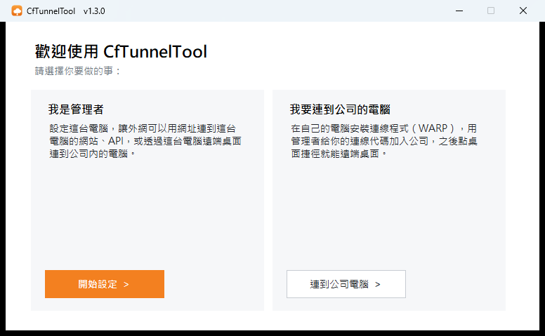
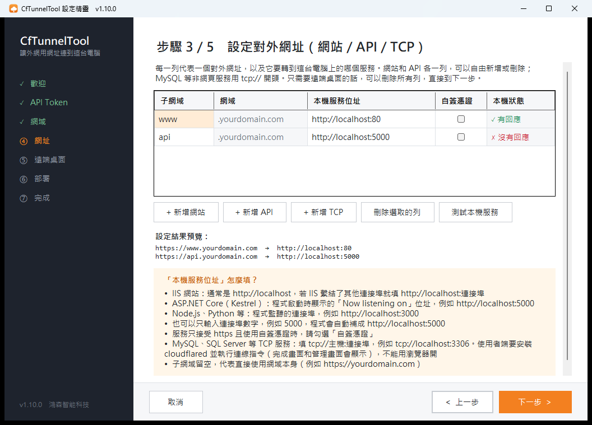
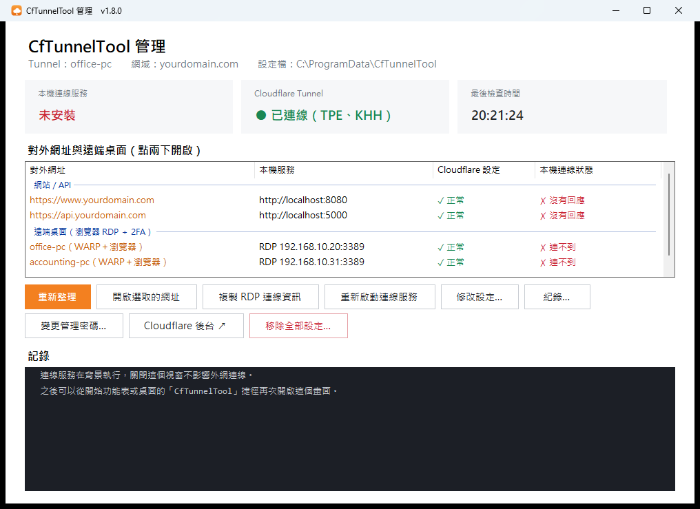
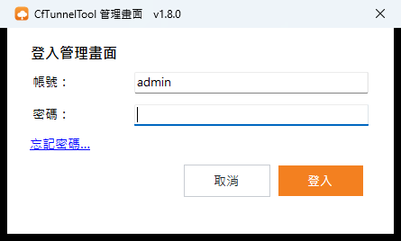
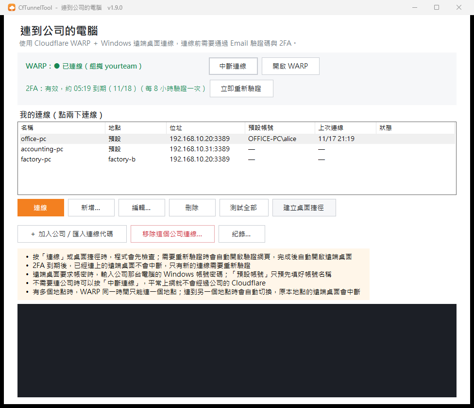
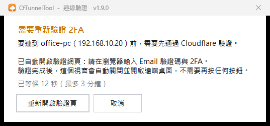
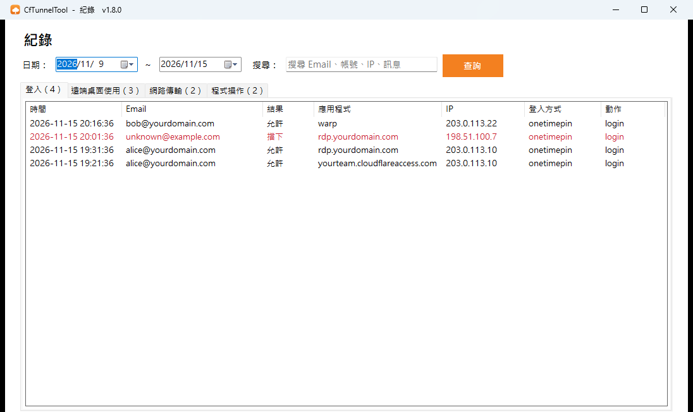

# CfTunnelTool

Windows 圖形介面工具，用 **Cloudflare Tunnel** 做兩件事：

- **對外網址**：讓外網用你自己的網域（例如 `https://api.yourdomain.com`）連到這台電腦上的網站和 API，也可以轉發 MySQL 等 TCP 服務（`tcp://`）
- **遠端桌面中繼**：讓使用者從外面連到公司內的電腦，連線前要先通過 **Email 驗證碼 ＋ 2FA**

```
                         ┌ Access：Email 驗證碼 ＋ 2FA
使用者 ──HTTPS / WARP──▶ Cloudflare ◀══ 加密通道（由內往外）══ cloudflared 服務（中繼電腦）
                                                                ├──▶ localhost:80 / :5000（網站、API）
                                                                └──▶ 區網電腦:3389（遠端桌面）
```

- 不需要固定 IP、不用設定路由器 Port Forwarding，遠端桌面連接埠完全不對外
- Cloudflare 自動提供 HTTPS
- 連線服務安裝成 Windows 服務，開機自動連線
- 全程圖形化引導，約 5 分鐘完成部署
- 單一執行檔，不需要安裝 .NET


## 目錄

- [下載與安裝](#下載與安裝)
- [三種使用模式](#三種使用模式)
- [管理者：設定精靈](#管理者設定精靈)
- [管理者：管理畫面](#管理者管理畫面)
- [API 網址（給程式呼叫）](#api-網址給程式呼叫)
- [TCP 服務（例如 MySQL）](#tcp-服務例如-mysql)
- [遠端桌面](#遠端桌面)
- [使用者端](#使用者端)
- [被連線的電腦](#被連線的電腦)
- [資安模型](#資安模型)
- [紀錄](#紀錄)
- [檔案位置](#檔案位置)
- [開發](#開發)

## 下載與安裝

1. 到 [Releases](../../releases/latest) 下載 `CfTunnelTool-<版本>-win-x64.zip`（私有 repo 需要先登入 GitHub）
2. 解壓縮後按兩下 `CfTunnelTool.exe`
3. 出現「Windows 已保護您的電腦」時，按「其他資訊」→「仍要執行」（程式還沒有程式碼簽章）
4. Windows 詢問權限時按「是」

也可以用 GitHub CLI 下載：

```bash
gh release download --repo ad823/CfTunnelTool --pattern "*.zip"
```

zip 內附的 [使用說明.txt](docs/使用說明.txt) 是給實際操作人員的逐步說明，包含常見問題與第一次部署的驗證清單。

**系統需求：** Windows 10 / 11（64 位元）、一個已加入 Cloudflare 的網域（只有中繼電腦需要）。被連線的電腦要是 Windows 專業版以上（家用版不能當遠端桌面主機）。

## 三種使用模式

第一次執行時選擇模式：



| 模式 | 誰用 | 需要 Cloudflare 帳號 | 需要管理密碼 |
|---|---|---|---|
| **我是管理者** | 中繼電腦（放在公司內、一直開機的那台） | 是 | 是 |
| **我要連到公司的電腦** | 在外面要連回公司的使用者 | 否 | 否 |
| **這台電腦要被遠端連線** | 公司內要讓人連進來的電腦 | 否 | 否 |

## 管理者：設定精靈

| 步驟 | 內容 |
|---|---|
| 1. API Token | 按按鈕開啟 Cloudflare 頁面，依畫面上的權限表建立 Token、貼上、驗證（程式會檢查權限是否足夠） |
| 2. 網域 | 從下拉選單選網域，取一個 Tunnel 名稱（預設為電腦名稱） |
| 3. 網址 | 設定「子網域 → 本機服務」，例如 `api` → `http://localhost:5000`、`mysql` → `tcp://localhost:3306`，給程式呼叫的網址勾選「API 用途」，可直接測試本機服務（只用遠端桌面可以不設） |
| 4. 遠端桌面（選用） | 連線方式、要開放的電腦、允許登入的 Email、2FA 方式與有效時間、剪貼簿與檔案傳輸權限 |
| 5. 部署 | 按「開始部署」，自動完成 Tunnel、DNS、Zero Trust 政策、下載 cloudflared、安裝服務，即時顯示進度 |

**API Token 權限：**

| 類型 | 權限 | 層級 | 用途 |
|---|---|---|---|
| Account | Cloudflare Tunnel | Edit | 必要 |
| Zone | DNS | Edit | 必要 |
| Zone | Zone | Read | 必要 |
| Zone | Config Rules | Edit | API 用途 |
| Account | Access: Apps and Policies | Edit | 遠端桌面 |
| Account | Access: Organizations, Identity Providers, and Groups | Edit | 遠端桌面 |
| Account | Zero Trust | Edit | 遠端桌面 |
| Account | Access: Audit Logs | Read | 紀錄 |
| Account | Account Analytics | Read | 紀錄 |

使用遠端桌面前，Cloudflare 帳號要先啟用 Zero Trust（[one.dash.cloudflare.com](https://one.dash.cloudflare.com/)，Free 方案即可，最多 50 位使用者）。

<table>
<tr>
<td></td>
<td></td>
</tr>
<tr>
<td></td>
<td></td>
</tr>
</table>

部署完成後，程式會把自己安裝到 `C:\Program Files\CfTunnelTool\`，並在開始功能表和桌面建立「CfTunnelTool」捷徑，之後開啟會直接進入管理畫面。程式已經開著時再點捷徑，不會跳出 UAC 或提示，會直接切回原本的視窗（最小化時自動還原）。

## 管理者：管理畫面



- 查看連線服務與 Tunnel 狀態，測試每個網址的本機服務與遠端桌面連接埠
- **複製 RDP 連線資訊**：給使用者的連線代碼與網址（不含任何密碼）
- **修改設定…**：回到精靈調整後重新部署
- **紀錄…**：登入、遠端桌面使用、網路傳輸、程式操作紀錄
- **重新啟動連線服務**、**Cloudflare 後台 ↗**、**移除全部設定…**（只刪除這台電腦建立的 Cloudflare 資源）

**管理帳號密碼**



- 第一次進入管理畫面時設定帳號與密碼（密碼至少 10 個字元，不能和帳號相同），之後每次開啟都要登入
- 連續錯誤 5 次鎖定 5 分鐘；閒置 15 分鐘自動鎖定畫面，部署等背景工作不會中斷
- 「變更管理密碼…」可更換密碼（要先輸入舊密碼）
- **忘記密碼**：登入畫面按「忘記密碼…」，輸入這個地點的 Cloudflare API Token，驗證 Token 能存取這個網域與 Tunnel 後重新設定。已儲存的 Token 不能用來重設，已部署的電腦刪除 `admin.dat` 也一樣要通過這個驗證
- **從舊版升級**：第一次開啟時會先要求 Cloudflare 驗證，再設定帳號密碼
- 「設定 → 應用程式」解除安裝時，已部署的電腦也要先登入

## API 網址（給程式呼叫）

Cloudflare 預設開啟 **Browser Integrity Check（瀏覽器檢查）**，會擋下看起來不是瀏覽器的請求。Python（`requests`、`urllib`、`httpx`）等程式用預設設定呼叫時，常會收到 **HTTP 403、Error 1010（browser_signature_banned）**；Postman、瀏覽器則正常。

精靈第 3 步替給程式呼叫的網址勾選 **「API 用途」**（按「+ 新增 API」新增的列預設勾選），部署時程式會在網域的 Configuration Rules 建立一條規則，只替這些網址關閉瀏覽器檢查：

| 項目 | 說明 |
|---|---|
| 規則 | `http.host in {"api.yourdomain.com" …}` → Browser Integrity Check 關閉 |
| 範圍 | 每個 Tunnel 一條規則（ref `cftunneltool_bic_<Tunnel 名稱>`），只新增／修改／刪除自己那一條，不會動到你手動加的其他規則 |
| 權限 | API Token 要有 `Zone → Config Rules → Edit`；沒有時部署照常完成，只顯示警告與手動設定方式 |
| 取消 | 取消勾選後重新部署，或移除部署，規則會一併刪除 |

給人用瀏覽器開的網站不用勾，保留防護。TCP 網址不經過瀏覽器檢查，不能勾。若勾選後程式仍被擋，請到 Cloudflare 主控台 → Security → Events 用回應的 `cf-ray` 查是哪個功能擋的；免費方案的 **Bot Fight Mode** 無法用規則排除，只能在 Security → Bots 關閉。

## TCP 服務（例如 MySQL）

精靈第 3 步按「+ 新增 TCP」（預設 MySQL 的 3306），或在本機服務位址填 `tcp://主機:連接埠`：

| 子網域 | 本機服務位址 | 說明 |
|---|---|---|
| `mysql` | `tcp://localhost:3306` | 這台電腦上的 MySQL |
| `sql` | `tcp://192.168.1.20:1433` | 區網另一台電腦的 SQL Server |

Cloudflare 的公開網址只直接轉發 HTTP(S)，所以 TCP 服務**不能用瀏覽器開，也不能讓 MySQL 用戶端直接連網址**。使用者端要先安裝 cloudflared，再開一個本機連接埠：

```
winget install --id Cloudflare.cloudflared
cloudflared access tcp --hostname mysql.yourdomain.com --url 127.0.0.1:3306
```

指令視窗保持開著，MySQL Workbench 等程式改連 `127.0.0.1:3306`，帳號密碼和原本一樣。自己電腦的 3306 已被占用時，把指令最後的連接埠改成其他號碼（例如 13306）。完成頁點 TCP 網址、或管理畫面選取後按「開啟選取的網址」，都會複製這份連線方式，可以直接貼給使用者。

> **TCP 網址沒有 Cloudflare 登入保護**：任何知道網址並安裝 cloudflared 的人都能連到這個服務，只剩服務本身的帳號密碼保護。精靈會在下一步前再確認一次。請使用強密碼、不要讓 root 從遠端登入、遠端帳號只給需要的資料庫與權限。

## 遠端桌面

兩種連線方式可以同時開啟，共用同一份電腦清單與允許登入的 Email：

| | WARP ＋ 遠端桌面連線（建議） | 瀏覽器 |
|---|---|---|
| 使用者端 | 安裝 Cloudflare WARP（CfTunnelTool 自動安裝） | 只要瀏覽器 |
| 流暢度 | 原生 mstsc，支援 UDP／H.264，接近內網 | 較慢 |
| 功能 | 聲音、多螢幕、印表機、剪貼簿圖片 | 文字剪貼簿（單次 500 KB）、檔案傳輸（Cloudflare Beta） |
| 適合 | 內部員工、常態使用 | 外部人員、偶爾使用 |

**登入順序：** Email 驗證碼 → 2FA（Authenticator App／安全金鑰／生物辨識）→ Windows 帳號密碼（NLA）。

**有效時間分開設定：**

| | 選項 | 預設 | 說明 |
|---|---|---|---|
| Email 驗證碼 | 1 小時／8 小時／24 小時／7 天 | 8 小時 | Zero Trust 組織的全域登入時間，整個 Cloudflare 帳號共用 |
| 2FA | 每次連線／1 小時／8 小時／24 小時 | 每次連線 | 在 Email 驗證碼有效期間重新連線，只需要再做 2FA |

做法是把組織的 `session_duration` 設為 Email 驗證碼的時間、應用程式工作階段設短（5 分鐘），並在應用程式與政策兩層都設定 `mfa_config`。

**部署時在 Cloudflare 自動建立：**

| 資源 | 用途 |
|---|---|
| Email 一次性驗證碼登入、組織 2FA | 使用者登入與 2FA |
| Tunnel 私有網路路由（每台電腦一條 `/32`） | 讓 Cloudflare 透過中繼電腦連到區網電腦 |
| 基礎架構目標（Targets）、DNS `rdp.網域` | 瀏覽器方式的連線目標與網址 |
| Access 應用程式與政策 | 允許的 Email、2FA、剪貼簿與檔案傳輸方向 |
| WARP 裝置註冊權限 | 只有允許的 Email、而且通過 2FA 才能把電腦加入組織 |
| Gateway TCP／UDP 代理、Split Tunnel | 讓被開放的電腦 IP（`/32`）走 WARP |
| 私有網路應用程式 | WARP 連線前也要通過 2FA |
| Gateway 網路規則 | 被開放的電腦透過 WARP 只能連遠端桌面連接埠，其他連接埠（例如 445）一律封鎖 |

WARP 的設定套用到帳號的預設裝置設定，但只影響被開放的 IP。移除或停用時，只刪除設定檔裡記錄、由這台電腦建立的資源。

**多個地點：** 每個地點各放一台中繼電腦，使用不同的 Tunnel 名稱、同一個 Cloudflare 帳號。2FA 註冊入口與 WARP 註冊權限整個帳號共用，各地點部署時只加入自己的 Email，移除時也只移除自己的部分。

**不同地點的內網 IP 相同：** 勾選「這個地點使用獨立的虛擬網路」，該地點的路由與目標會放在自己的虛擬網路（`cft-Tunnel名稱`），兩個廠區的 `192.168.1.10` 不會衝突。WARP 同一時間只能連一個地點，使用者端連線時會自動切換。

**加入 Microsoft Entra ID 的電腦：** 用瀏覽器方式登入需要關閉 NLA，所以程式偵測到這台電腦只加入 Entra ID（沒有加入 AD 網域）時，不會自動開啟 NLA，改在「被連線的電腦」畫面顯示警告與手動開啟／關閉按鈕。建議改用 WARP 方式連線並開啟 NLA；一定要用瀏覽器方式時才關閉。同時加入 AD 網域的混合加入電腦照常強制開啟 NLA。

## 使用者端



使用者在自己的電腦執行 CfTunnelTool，選「我要連到公司的電腦」，貼上管理者給的連線代碼（`CFT1:` 開頭，只含組織名稱與內網 IP，不含密碼）。程式會從 Cloudflare 官方網站下載安裝 WARP、加入組織，並建立遠端桌面捷徑。

**連線前自動驗證：** 按「連線」或桌面的「遠端桌面 - 電腦名稱」捷徑時，程式會先測試連不連得到。連不到（通常是 2FA 到期）就自動請 WARP 開啟驗證網頁（`warp-cli debug access-reauth`），同時跳出置頂的等候視窗並發出提示音；使用者在瀏覽器完成 Email 驗證碼與 2FA 後，程式自動開啟遠端桌面，不用再找右下角的通知。最多等 3 分鐘，逾時會列出可能原因。



桌面捷徑執行 `CfTunnelTool.exe --connect "電腦名稱"`，以一般權限執行、**不會跳出 UAC**；其他功能（安裝 WARP、匯入、管理）仍會要求系統管理員權限。舊版建立的 `.rdp` 桌面捷徑會在開啟使用者畫面時自動換成新捷徑。

- **我的連線**：新增、編輯、刪除電腦，點兩下連線，記錄上次連線時間；匯入新的連線代碼會自動合併
- **中斷／重新連線 WARP**：不用連公司時中斷，平常上網不經過公司
- **2FA 狀態**：顯示是否有效、約何時到期；「立即重新驗證」可以提前驗證
- **移除這個公司連線**：登出 WARP 組織、刪除清單與捷徑，可一併解除安裝 WARP

瀏覽器方式不需要安裝任何程式：先開啟管理者提供的「註冊 2FA 裝置」網址註冊 2FA，之後開啟各台電腦的連線網址即可。

## 被連線的電腦

在區網內要開放的電腦執行 CfTunnelTool，選「這台電腦要被遠端連線」。不需要 Cloudflare 帳號，也不用部署。

| 項目 | 說明 |
|---|---|
| 啟用遠端桌面 | 一鍵啟用，同時自動限制防火牆來源並開啟 NLA（只加入 Entra ID 的電腦不修改 NLA） |
| 防火牆來源 | 只允許同網段與私有 IP（10.x／172.16–31.x／192.168.x）。經 Cloudflare 連進來不受影響；路由器轉送、DMZ、UPnP 造成的直接暴露會被擋掉 |
| NLA（網路層級驗證） | 開啟畫面時自動開啟，帳號密碼驗證通過才建立工作階段。群組原則強制關閉時不會覆寫，畫面以紅字顯示 gpedit 修改路徑（網域電腦請洽 IT）。只加入 Microsoft Entra ID 的電腦不自動開啟：顯示警告（瀏覽器方式需要關閉 NLA、建議改用 WARP），並提供「開啟 NLA」／「關閉 NLA」按鈕，關閉前會再確認 |
| 遠端登入密碼 | 空白密碼的帳號不能遠端登入。可幫本機帳號設定密碼（至少 8 個字元）、加入 Remote Desktop Users，並**保留開機自動登入**（密碼存在 Windows LSA 機密，做法同 Sysinternals Autologon）。遠端登入時帳號輸入 `電腦名稱\帳號` |
| 結束遠端並交還畫面 | 桌面捷徑，用 `tscon` 把工作階段交還本機螢幕，電腦前面直接回到桌面。需要系統管理員權限，交還後螢幕是未鎖定的 |

中繼電腦本身若也在開放清單中，部署時會自動套用相同的防火牆限制與 NLA；只加入 Entra ID 的中繼電腦不修改 NLA，部署記錄會顯示警告。

## 資安模型

### 分層防護

| 層級 | 做法 | 擋下什麼 |
|---|---|---|
| 網路入口 | Cloudflare Tunnel 由內往外連線，路由器不開任何連接埠 | 網際網路直接掃描、暴力破解遠端桌面 |
| 身分驗證 | Cloudflare Access：允許清單 Email ＋ Email 驗證碼 ＋ 2FA | 不在名單內或沒有 2FA 裝置的人 |
| WARP 裝置 | 註冊裝置要通過 2FA；Gateway 規則只開放遠端桌面連接埠 | 未授權裝置加入組織、透過 WARP 存取其他服務 |
| 主機防火牆 | 遠端桌面只接受內部網路來源 | 路由器轉送、DMZ、UPnP 造成的直接暴露 |
| 主機登入 | 強制 NLA，檢查群組原則 | 未驗證就建立工作階段、消耗主機資源 |
| 管理工具 | 管理帳號密碼（PBKDF2-SHA256 600,000 次加鹽雜湊）、失敗鎖定、閒置鎖定 | 能碰到中繼電腦的人隨手開啟管理畫面 |
| 金鑰保存 | API Token 以 DPAPI 加密；服務只用權限較小的 Tunnel Token | 設定檔外流時直接取得 API 權限 |
| 稽核 | 登入、遠端桌面、網路、程式操作紀錄，可每小時自動收集 | 事後追查 |

外部攻擊者要連到遠端桌面，必須同時取得：使用者的 Email 信箱、2FA 裝置、被連電腦的 Windows 帳號密碼。

### 管理者應自行加強

1. **中繼電腦**：Windows 帳號使用強密碼、保持更新、開啟防毒；不要拿來上網或收信。部署時建議**不要勾選記住 Token**
2. **Cloudflare 帳號**與**使用者的 Email 信箱**都要開啟 2FA；API Token 只給需要的權限並設定到期日
3. 允許清單盡量列個別 Email，少用 `@公司網域.com`
4. 路由器不要轉發 3389，並關閉 UPnP
5. 被連電腦的 Windows 帳號使用強密碼，保留帳號鎖定原則
6. 啟用紀錄自動收集，定期查看登入失敗；遠端桌面紀錄出現**公網 IP** 的登入失敗，代表這台電腦被直接暴露
7. 有敏感資料時，關閉瀏覽器方式的檔案下載

### 已知限制

- **管理密碼不是真正的安全界線**：能執行本程式的人本來就是 Windows 系統管理員，可以直接操作服務或解開同一使用者的 Token。真正的界線是中繼電腦的 Windows 帳號
- **內部網路的電腦仍可直接嘗試登入遠端桌面**：此時只靠 NLA 與 Windows 密碼強度
- **沒有裝置狀態檢查（device posture）**：中毒的電腦只要使用者通過 2FA 仍可連線
- **沒有主動告警**：紀錄需要人去看
- **網站和 API 是公開的**：任何人都能連線，請自行做好登入驗證；勾選「API 用途」的網址還會關閉 Cloudflare 的瀏覽器檢查；只給內部使用的網址可以在 Cloudflare → Zero Trust → Access → Applications 加上登入保護
- **TCP 服務（例如 MySQL）也是公開的**：程式不會替 `tcp://` 網址加登入保護，只靠服務本身的帳號密碼
- 部署時不會覆寫你現有的 DNS 紀錄或別台電腦的 Tunnel，遇到衝突會先停下來詢問

## 紀錄



| 紀錄 | 來源 | 內容 |
|---|---|---|
| 登入 | Cloudflare Access | Email、時間、IP、服務、允許／擋下 |
| 遠端桌面使用 | 被連電腦的 Windows 事件 | Windows 帳號、連入／中斷／登出、時長、登入失敗 |
| 網路傳輸 | Cloudflare Gateway（WARP，抽樣統計） | 使用者、目的電腦、傳送／接收量 |
| 程式操作 | CfTunnelTool | 部署、修改、移除、連線、管理畫面登入等 |

可依日期與文字篩選，並匯出 CSV。Cloudflare 免費方案只保留登入與網路紀錄 24 小時，「啟用每小時自動收集」會建立以 SYSTEM 執行的 Windows 排程，把紀錄存到 `C:\ProgramData\CfTunnelTool\logs`（僅系統管理員可讀，預設保留 365 天）。

遠端桌面使用紀錄的來源 IP 是中繼電腦，使用者身分請對照同時間的登入紀錄。

## 檔案位置

| 位置 | 內容 |
|---|---|
| `C:\ProgramData\CfTunnelTool\config.json` | 網域、Tunnel、網址、遠端桌面設定（不含密鑰） |
| `C:\ProgramData\CfTunnelTool\token.dat` | DPAPI 加密的 API Token（選擇記住時才有） |
| `C:\ProgramData\CfTunnelTool\admin.dat` | 管理帳號與密碼雜湊（不含明文，只有 Administrators 與 SYSTEM 可讀） |
| `C:\ProgramData\CfTunnelTool\logs\` | 收集的紀錄 |
| `C:\Program Files\CfTunnelTool\CfTunnelTool.exe` | 管理程式 |
| `C:\Program Files\cloudflared\cloudflared.exe` | Cloudflare 官方連線程式（從官方 GitHub 下載） |
| Windows 服務 `Cloudflared` | 開機自動執行的連線服務 |

## 開發

需要 .NET 9 SDK。

| 路徑 | 內容 |
|---|---|
| `CfTunnelTool/Core/` | 與介面無關的邏輯：Cloudflare API、部署流程、cloudflared 服務、遠端桌面主機、管理帳號、設定儲存 |
| `CfTunnelTool/Core/Logs/` | 紀錄收集與儲存 |
| `CfTunnelTool/UI/` | 設定精靈、管理畫面、使用者端、被連線電腦畫面 |
| `CfTunnelTool/UI/Steps/` | 精靈的每一個步驟 |
| `docs/` | 使用說明（會放進部署包）與截圖 |
| `.github/workflows/release.yml` | 自動建置與發布 Release |

本機建置單一執行檔（產生 `CfTunnelTool/publish/CfTunnelTool.exe`）：

```bat
CfTunnelTool\publish.cmd
```

截圖與自我測試（只有 Debug 版有；使用假資料，不會修改系統或 Cloudflare 設定）：

```bat
dotnet build CfTunnelTool
CfTunnelTool\bin\Debug\net9.0-windows\CfTunnelTool.exe --screenshots %TEMP%\cftunnel-shots
CfTunnelTool\bin\Debug\net9.0-windows\CfTunnelTool.exe --selftest %TEMP%\cftunnel-selftest.txt
```

自我測試涵蓋：遠端桌面主機狀態與 NLA 判斷（含 Entra ID 例外）、防火牆規則、管理帳號密碼、桌面捷徑參數與路徑、TCP 網址轉發、API 網址關閉瀏覽器檢查、重複開啟時喚醒原本的視窗、設定驗證規則、連線代碼、送給 Cloudflare 的 JSON 結構、API 錯誤處理。

### 發布新版本

合併到 main 後推送版本標籤，GitHub Actions 會自動建置並建立 Release，附上 zip 部署包與 SHA256。程式顯示的版本號由標籤決定（建置時傳入 `-p:Version`）；`CfTunnelTool/CfTunnelTool.csproj` 的 `<Version>` 建議一併更新，讓本機建置的版本號一致。

```bash
git tag v1.8.1 origin/main
git push origin v1.8.1
```

也可以到 GitHub 的 **Actions → Release → Run workflow** 輸入版本號手動發布。

## 發行商

鴻森智能科技 HONGSEN Intelligent Technology Co.,Ltd.

程式內含公司資訊，會顯示在檔案內容和「設定 → 應用程式」。目前執行檔沒有程式碼簽章，所以 UAC 視窗會顯示「不明的發行者」，SmartScreen 也會跳出藍色警告。取得程式碼簽章憑證後，可以在 GitHub Actions 發版時自動簽章。
